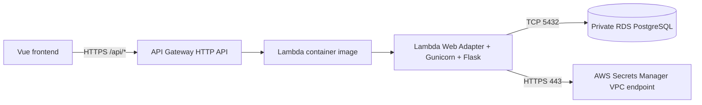

# NASE-842 — RealWorld Flask Backend

**Flask + PostgreSQL | Docker | AWS Lambda (container image) | API Gateway**

This repository contains the REST API for **NASE-842**, a deployed RealWorld/Conduit blogging application built for a DevOps final assessment. The backend is adapted from [mhegelheimer/realworld-flask](https://github.com/mhegelheimer/realworld-flask), rather than implemented from scratch. The main assessment work is the AWS deployment, Docker/Lambda adaptation, networking, credential integration, and CI/CD.

| Resource | URL |
| --- | --- |
| Website | https://realworld.eldeeb-o-skillup.vertexlab.net |
| API | https://api.realworld.eldeeb-o-skillup.vertexlab.net |
| Health endpoint | https://api.realworld.eldeeb-o-skillup.vertexlab.net/api/ping |
| Frontend repository | [nase842-frontend](https://github.com/OmarElDeeb-exe/nase842-frontend) |
| Terraform repository | [nase842-infra](https://github.com/OmarElDeeb-exe/nase842-infra) |
| Deployment workflow | [.github/workflows/deploy.yml](.github/workflows/deploy.yml) |

## API and data flow



API Gateway invokes the `nase842-flask` Lambda function for matching `/api` routes. The Lambda Web Adapter converts Lambda requests into HTTP requests for Gunicorn/Flask, listening on port **8080**. Flask supplies registration/login, article and tag APIs, profiles, and authenticated actions. PostgreSQL persists user and article data. Lambda runs inside two private subnets and connects to RDS through security-group-controlled PostgreSQL traffic.

This is **not** a continuously running ECS service: AWS Lambda runs the packaged backend on demand. Terraform resources are documented in the [infrastructure repository](https://github.com/OmarElDeeb-exe/nase842-infra).

## Key implementation files

| Path | Purpose |
| --- | --- |
| `realworld/app.py` | Flask app, blueprints, CORS, and `/api/ping` |
| `realworld/api/core/auth.py` | JWT issue/verify logic, signing-secret retrieval |
| `realworld/api/core/db.py` | PostgreSQL engine; AWS Secrets Manager or local environment credentials |
| `alembic/` and `alembic.ini` | Database schema migrations |
| `Dockerfile.local` | Python 3.11 local runtime |
| `Dockerfile.lambda` | Lambda-compatible image (Web Adapter + Gunicorn) |
| `docker-compose.yml` / `docker-compose.override.yml` | Local Flask and PostgreSQL environment with persistent `pgdata` volume |
| `.github/workflows/deploy.yml` | Docker/ECR/Lambda deployment and health check |
| `tests/` | Existing API test modules |

## Run locally

Prerequisites: Docker Engine and Docker Compose. Clone the repository:

```bash
git clone https://github.com/OmarElDeeb-exe/nase842-backend.git
cd nase842-backend

# Docker Compose automatically loads the override file.
docker compose up --build -d

# Apply initial schema and future migration revisions.
docker compose exec realworld alembic upgrade head

# Verify the API.
curl -fsS http://127.0.0.1:8080/api/ping
curl -fsS http://127.0.0.1:8080/api/tags
curl -fsS http://127.0.0.1:8080/api/articles
```

The Docker Compose files bind Flask to **127.0.0.1:8080** and PostgreSQL to **127.0.0.1:15432** (container port 5432), avoiding external exposure. PostgreSQL data persists in the `pgdata` named volume. The local Compose defaults (`testuser` / `changeme`) are **development-only placeholders**, never production credentials.

### Local JWT setup

The backend requires a signing secret of at least **32 characters** for user authentication. `realworld/api/core/auth.py` reads `JWT_SECRET_ARN` from AWS Secrets Manager in the cloud, or `SECRET_KEY` locally. The supplied Compose file does **not** forward `SECRET_KEY`, so if you need to exercise registration/login locally, create an **untracked** Compose override or pass it explicitly:

```bash
# Example for a disposable local development session.
export SECRET_KEY="$(python3 -c 'import secrets; print(secrets.token_urlsafe(48))')"
docker compose run --rm -e SECRET_KEY="$SECRET_KEY" realworld \
  flask run --host=0.0.0.0 --port=8080
```

For an ongoing local development setup, configure the same `SECRET_KEY` on the running Flask service using a local, untracked configuration; do not commit the value or use it for production. The sample `docker compose run` command is a separate one-off container, not a replacement for `docker compose up -d`. JWTs include issuer, issue time, and expiry and are validated server-side.

## Production build and CI/CD

Source: [.github/workflows/deploy.yml](.github/workflows/deploy.yml)

On an ordinary push to `main`, the GitHub Actions workflow:

1. Assumes a repository-scoped AWS IAM role using **OIDC**, not permanent AWS credentials.
2. Checks that the caller is the expected AWS account.
3. Builds `Dockerfile.lambda` for `linux/amd64`.
4. Tags the image with commit SHA and workflow run identifiers, then pushes to **Amazon ECR**.
5. Updates the existing `nase842-flask` Lambda function image, waits for success, and calls the public `/api/ping` health endpoint.

The Lambda image contains **Python 3.11, AWS Lambda Web Adapter, Poetry, boto3, Flask, and Gunicorn**. Its adapter readiness check uses `/api/ping`. The CI workflow deploys and performs a health smoke test; it does **not** automatically run the repository's complete pytest suite.

Production secrets are not built into the image:
- **Database username/password:** managed by RDS and retrieved via Secrets Manager using `DB_SECRET_ARN`.
- **JWT signing key:** read using `JWT_SECRET_ARN`; the secret must be populated securely after creation.
- **Database host/name:** supplied through Lambda configuration.

Access to Secrets Manager from the private VPC is provided by a **private interface VPC endpoint**. The deployment role and runtime role are separate. The live system uses PostgreSQL 15 on private RDS, not the local development database.

## Tests and reviewer verification

```bash
# Public HTTPS and health
curl -fsS https://api.realworld.eldeeb-o-skillup.vertexlab.net/api/ping

# Read-only application endpoints
curl -fsS https://api.realworld.eldeeb-o-skillup.vertexlab.net/api/tags
curl -fsS https://api.realworld.eldeeb-o-skillup.vertexlab.net/api/articles

# Unauthenticated protected endpoint should reject access.
curl -i https://api.realworld.eldeeb-o-skillup.vertexlab.net/api/user
```

For full functional verification, register a disposable user through the website, log in, create an article, and refresh the page. The article should persist in PostgreSQL across page reloads. Review GitHub Actions run history and CloudWatch Lambda logs for deployment and invocation evidence.

The existing `tests/` folder provides API tests. **Note:** some original development tooling (`./run` and `scripts/run-api-tests.sh`) comes from the upstream project and may need environment-specific setup; these scripts are not the production deployment path.

## Security and intentional assessment tradeoffs

- RDS is private; only the Lambda security group is allowed to connect to PostgreSQL port 5432.
- The runtime retrieves credentials from Secrets Manager, instead of embedding DB passwords or JWT signing keys in source.
- JWT verification checks issuer and expiry.
- **Known limitation:** `realworld/app.py` currently calls `CORS(app)` without a production-origin allowlist. Restricting permitted browser origins is a recommended hardening improvement.
- This is a cost-conscious **assessment deployment**, not a production HA design. See the infrastructure README for recovery and deployment limitations.

## Original project and license

Flask/RealWorld application adapted from [mhegelheimer/realworld-flask](https://github.com/mhegelheimer/realworld-flask) and the [RealWorld specification](https://github.com/gothinkster/realworld). Original authors retain credit; see [LICENSE](LICENSE). The deployment architecture and operational integration are the NASE-842 work documented across these repositories.
